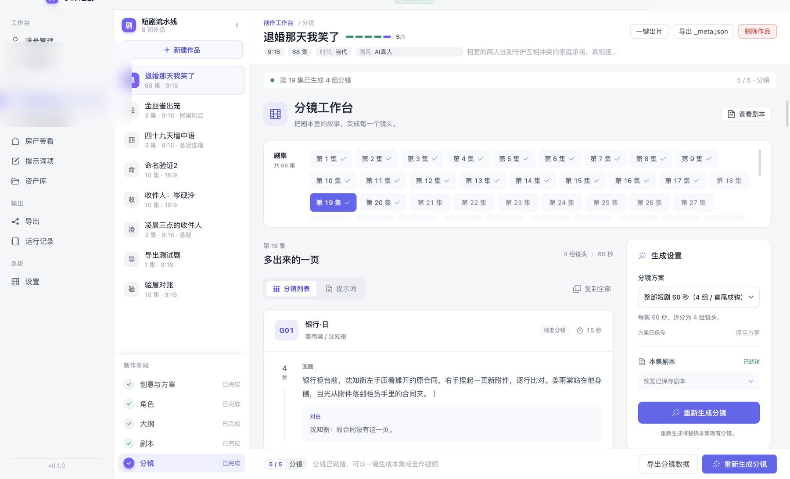
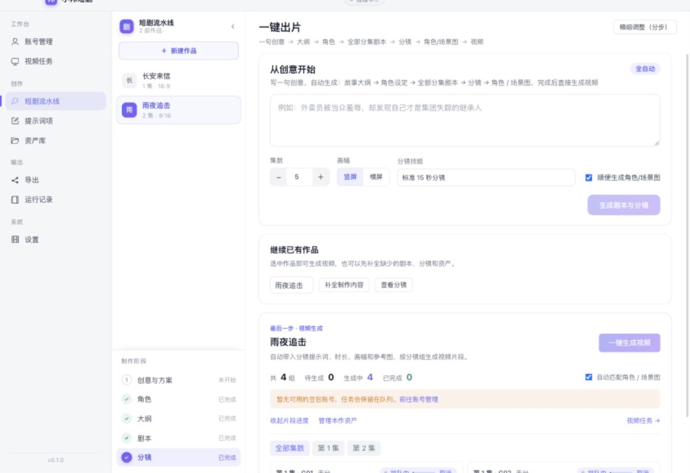
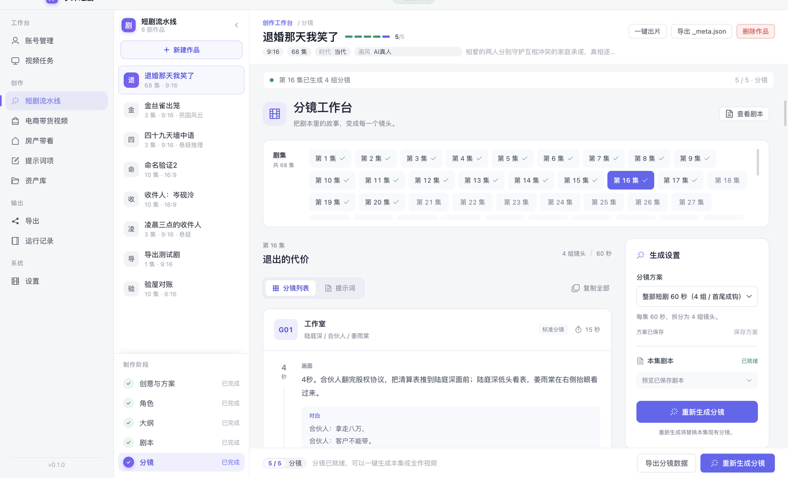
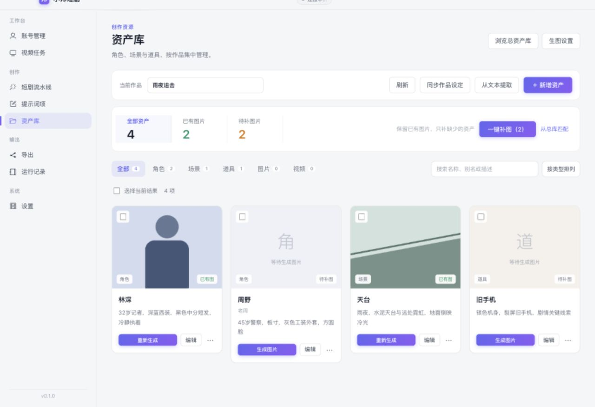
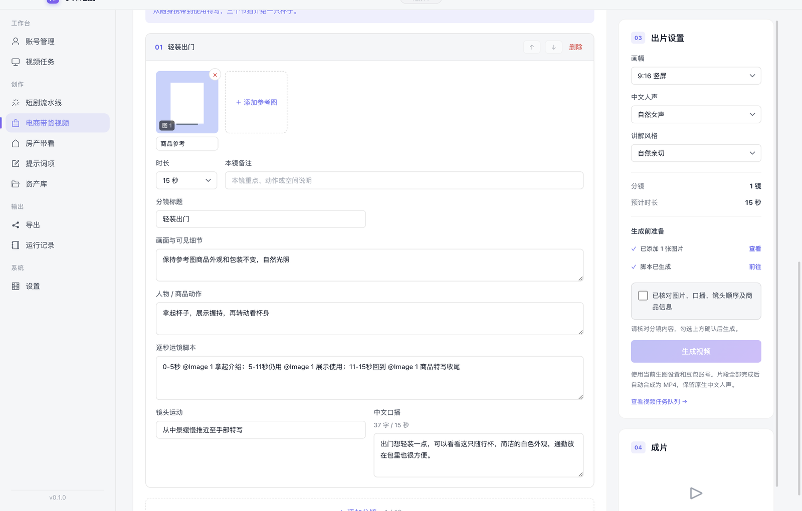
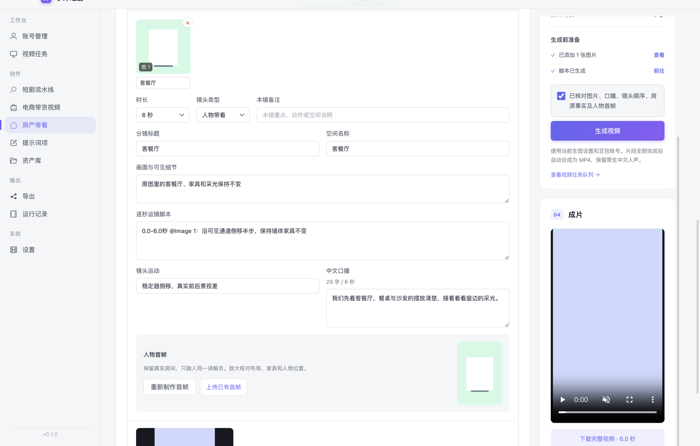
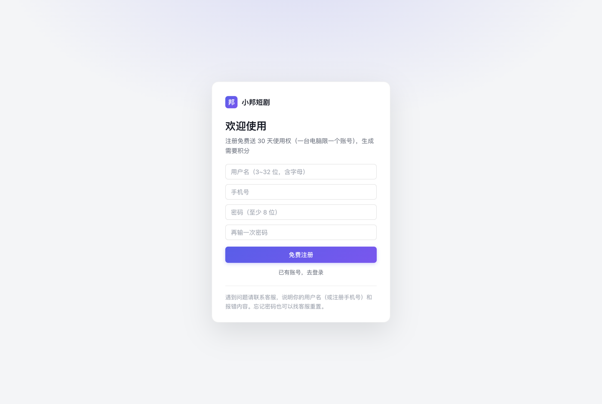

# 小邦短剧 · AI 短剧自动化工作台

**加一个豆包账号，就能免费做短剧、免费生图、免费出视频。**

AI 写剧本 → AI 画分镜 → AI 出图 → AI 出视频 → 一键发布抖音，全程在一个软件里完成。

免费的是 <b>出图</b> 和 <b>出视频</b>（花的是你自己豆包账号的每日额度）；只有「让 AI 写剧本 / 分镜」这一步用积分，¥3 起。

---

## 这是什么

**小邦短剧是一款面向普通人（非技术用户）的 AI 短剧制作软件。**

你不需要懂提示词、不需要买 API、不需要配置大模型、不需要会剪辑。
装好软件、注册一个账号、登录一个豆包账号，就能从一句创意开始，做出能直接发抖音的竖屏短剧。

它做的事，本质上是把「一个人干一个剧组的活」压缩成点几下按钮：

| 以前 | 现在 |
| --- | --- |
| 找编剧写剧本，等三天 | 输入一句创意，几分钟出 3 个故事方案 |
| 找画师画角色，反复沟通一致性 | AI 自动锁人物形象、服装、场景，全剧不换脸 |
| 找剪辑师排分镜、对字幕、合片 | 分镜、画面、字幕、合片一条龙跑完 |
| 一个个镜头手动去生成、下载、改文件名 | 全自动排队出片，无水印原片直接落盘 |
| 导出、加字幕、传抖音 | 一键导出剪映草稿，一键发布抖音 |

> **一句话：小白当天就能做出第一部 AI 短剧，一个号一天出两条视频，想快就多加几个号。**

---

## 为什么选它

### 🆓 真的免费 —— 不用买大模型

市面上不少 AI 短剧工具，本质是**转卖 API**：你付的钱主要是模型调用费。
小邦短剧走的是另一条路：**出图和出视频，用的是你自己的豆包账号**（豆包每天送免费额度）。

所以：

- **不需要填 API Key**，不需要 OpenAI / Claude / 通义 账号
- **不需要懂参数**，不需要选模型、调采样、写系统提示词
- **出图免费**，**出视频免费** —— 花的是豆包送你的每日额度，不是钱
- 一个豆包账号一天能出 **2 条视频 + 8 张图**；软件支持**多账号**，账号越多产能越高

### 🧠 只有「动脑子」的部分才花积分

写故事、写分镜、写脚本、写小说，这些是**大模型**在干活，需要算力，所以用积分。
积分非常便宜：**¥3 起，约合 127 集剧本**。

**做一条短剧视频本身，不花积分。**

> 说清楚边界：注册送的是 **30 天使用权**（一台电脑限一个账号），**不含积分**。
> 也就是说，30 天里软件可以随便用、免费生图免费出片，但「让 AI 写剧本」这一步
> 需要先买积分（最低 ¥3）。我们不在试用里塞假额度，也不让你到第 30 天才发现要付钱。

### 🎬 不是「生成一段视频」，是「做一部剧」

单条 AI 视频谁都能生成，难的是**一部剧几十集、几百个镜头，人物还是同一个人**。
（我们自己的测试库里，一部 68 集的剧已经拆出 156 个镜头，12 个角色贯穿全剧。）
小邦短剧解决的就是这件事：

- **角色一致性四锚点**：视觉锚点 / 人物锚点 / 音色锁定 / 场景锚点，跨集不换脸
- **撞脸检测**：两个角色至少 3 项特征不同，否则重写
- **上下文瘦身**：写第 30 集时只喂它需要的信息，不串戏、不忘设定
- **题材 DNA 库**：每个题材有专属的核心冲突、节奏和桥段池，不是套模板

### ⚡ 全自动，不用守着

排好队就可以去睡觉。
软件会自动切账号、自动换号重试、自动识别额度耗尽、自动重新排队，出片后无水印原片直接存到本地。

---

## 功能总览

### 📖 短剧流水线 —— 一句创意，出完整剧本

- 五阶段向导：故事设定 → 角色设计 → 大纲 → 逐集剧本 → 分镜
- 一次给 **3 个不同叙事方向**的故事方案，挑一个继续
- 自动生成人物小传、视觉锚点、音色、服装与场景设定
- 内置 **65 个题材**（都市情感 / 豪门恩怨 / 战神归来 / 悬疑推理…）+ 8 个打斗专属题材，每个题材有自己的 DNA
- 时代（当代 / 民国 / 古代 / 未来）与画风是两个独立维度，可以随便组合
- 每集时长 30~180 秒可选，按 15 秒一组切镜头

### 🎞 一键出片 —— 不用懂剧本也能出片

- 选题材、选风格、选集数，剩下的全自动
- 角色图、场景图、道具图自动补齐，不用手动一张张生成
- 逐镜出视频 → 按台词烧字幕 → 换场硬切 / 同场叠化，自动合成整集 MP4
- 长任务会提醒你「先跑 3 集确认风格」，满意再加集数重跑

### 📚 长篇小说 · 设定驱动 —— 写百万字不崩设定

- 六份核心档案：创作总纲 / 世界观 / 人物 / 时间线 / 伏笔账本 / 文风手册
- 分卷纲 → 章节卡 → 五场景计划，逐章推进，不会一次生成 400 章
- 每 10 章自动做一次**只读**连续性审查，只指出问题，绝不偷偷改你写好的正文
- 导出 Markdown / TXT，包含全部档案与已发生事实账本

### 🖼 资产库 + 免费生图 —— 一次生成，全剧复用

- 五类资产统一管理：角色 / 场景 / 道具 / 图片 / 视频
- 一键给缺图资产补图，走豆包画布出图，**不花积分**
- 支持参考图、别名、批量补图，跨集保持同一张脸

### 🎭 人生副本 —— 把你的故事拍成短剧

- 给一个主题，推演「如果是你」的十年人生
- 酸 / 甜 / 苦 / 辣 四类处境种子（共 12 条，都是「带刺」的真实处境），一键套用
- 故事弧 → 旁白分镜 → 配图 → 成片，全程可改
- 6 种旁白音色（低沉叙事 / 自然生活 / 温暖偏慢 / 沉稳男声…），点「试音」就能先听，满意再定

### 🛒 电商带货视频 —— 商品图变成带货短片

- 上传商品主图（每镜最多 5 张、全片最多 12 镜），填材质与特征、已确认卖点
- AI 编排分镜、口播文案、逐秒运镜脚本
- 镜头 6 / 10 / 15 秒可选，男女声可选，4 种讲解风格（自然亲切 / 轻快有感染力 / 专业可信 / 克制高级）

### 🏠 房产带看视频 —— 房源实拍变成带看片

- 一次传最多 20 张房源实拍（总时长上限 120 秒），自动排分镜、自动写带看脚本
- 自然带看（每张实拍独立一镜）/ 经典多图（每镜最多 3 张，逐图轻推）两种模式
- 支持上传讲解员形象照、人物首帧（保留真实房间只融入同一个人）、逐镜运镜脚本

### 更多能力

| 功能 | 说明 |
| --- | --- |
| **多账号管理** | 每个豆包账号独立浏览器分区 + 独立指纹（UA / 分辨率 / 时区 / WebGL / 画布噪声），登录态互不干扰，可同时挂多个号轮流出片 |
| **无水印原片** | 自动取回豆包生成的原始视频文件，取不到就明确报失败，绝不拿带水印的片子当成成功交给你 |
| **一键发布抖音** | 半自动（停在发布按钮前由你点）/ 全自动两种模式；一次可排多集 × 多账号，同一账号两次发布至少间隔 3 分钟、一天最多 3 条 —— 不是限你，是别让平台判成机器人 |
| **导出剪映 / FCP7** | 生成剪映草稿或 FCP7 XML，外挂 SRT 字幕，想自己再剪一遍也行 |
| **短剧集观看端** | 作品墙 → 集列表 → 页内播放器，做完直接看 |
| **运行记录** | 每个任务的每一步都有记录，出问题能查 |

---

## 界面预览

### 工作台总览

账号、作品、分镜、素材、出片进度，一屏看完。

### 短剧流水线

左边选阶段，中间填创意，右边出结果。五个阶段做完，一部剧就成型了。

### 分镜工作台

每个镜头都能单独调：提示词、参考图、时长、状态。

### 资产库

角色、场景、道具统一管理，一键补图，全剧复用。

### 电商带货视频

商品主图 + 卖点 → 分镜脚本 + 口播 → 成片。

### 房产带看视频

房源实拍自动排分镜，支持讲解员形象与逐秒运镜。

### 成片效果

下面是两部剧的成片封面 —— 图是豆包按分镜提示词生成的，字是后期烧上去的。
左边是《代驾司机签下首领的名字》第 4 集，右边是《退婚那天我笑了》第 3 集。

&nbsp;&nbsp;&nbsp;

---

## 三步上手

> 全程不超过 10 分钟，不需要任何技术背景。

### 第一步：注册（免费送 30 天）

打开软件 → 点「注册」→ 填用户名、手机号、密码。
**不需要绑卡，不需要付钱，注册完就能进主界面。**

### 第二步：加一个豆包账号

点「新增账号」→ 在弹出的浏览器里登录你自己的豆包账号。
登录一次就会记住，以后不用再登。

> 豆包账号免费注册，每天送 2 条视频 + 8 张图额度。
> 想提高产能？多加几个账号就行，软件会自动轮着用。

### 第三步：开始做剧

点「一键出片」→ 输入一句创意 → 选短剧风格 / 时代 / 画风 / 集数 → 点开始。

剩下的它自己跑：写故事 → 定角色 → 画图 → 出视频 → 合片。
你去干别的，回来收片就行。

> 注意：写剧本这一步要积分（¥3 起，够跑约 127 集）；出图、出片不花积分。
> 注册送的 30 天不含积分，所以第一次做剧之前先充个 ¥3 就行。

---

## 免费与积分

这里把话说清楚，不玩文字游戏。

### 免费的部分

| 项目 | 花不花积分 | 说明 |
| --- | --- | --- |
| 软件本体 | ❌ 免费 | 注册即用；前 30 天免费，之后买时长卡（月卡 ¥69 / 年卡 ¥599） |
| **AI 生图** | ❌ **免费** | 走你自己的豆包账号，消耗豆包每日免费额度 |
| **AI 出视频** | ❌ **免费** | 同上，消耗豆包每日免费额度 |
| 无水印下载、合片、导出 | ❌ 免费 | 全部本地完成 |
| 多账号管理、指纹隔离 | ❌ 免费 | 不限账号数量 |

### 需要积分的部分

| 项目 | 为什么收费 |
| --- | --- |
| 写故事设定 / 角色 / 大纲 | 大模型算力 |
| 写逐集剧本 / 分镜脚本 | 大模型算力 |
| 写小说（长篇） | 大模型算力 |
| 人生副本 / 带货口播文案 | 大模型算力 |

**简单说：动脑子的部分要积分，动手（出图出片）的部分免费。**

### 积分价格

| 档位 | 价格 | 给什么 | 约合剧本 |
| --- | --- | --- | --- |
| 试用 | **¥0** | 30 天使用权（不含积分，一台电脑限一个账号） | — |
| 积分包 | **¥3** | 300 积分 | 约 127 集 |
| 积分包 | **¥5** | 500 积分 | 约 212 集 |
| 积分包 | **¥10** | 1,000 积分 | 约 424 集 |
| 月卡 | **¥69** | 30 天 + 300 积分 | 约 127 集 |
| 年卡 | **¥599** | 365 天 + 3,000 积分 | 约 1,271 集 |

> 积分一次到账、**不过期**。积分包只买积分，月卡/年卡卖的是「到期之后还能不能继续用」。
> 建议先用 ¥3 试一下手感，觉得顺手再上月卡。
> （「约合多少集」是按历史平均 token 估算的参考值，不是承诺。）

---

## 常见问题

<b>真的免费吗？会不会用着用着收费？</b>

做视频和生图是**真免费**，用的是你自己豆包账号的免费额度，软件不抽成、不代收。
只有「让 AI 写剧本」这种需要大模型算力的功能才消耗积分，最低 ¥3 起。

注册送 30 天使用权，这 30 天里软件所有功能都能用，但生成剧本要先买积分（我们没在试用里
假装送额度）。到期后想继续用需要买时长卡，但**已经做好的作品、已经导出的成片，
永远是你的，随时能导出**——到期只是不能再新建任务，不会把你锁在门外。

<b>需要会写提示词吗？</b>

不需要。软件内置了题材 DNA 库、分镜模板、风格预设，你只需要说「我想做一个关于××的短剧」，
剩下的提示词它会自己写。当然，你想改也能逐条改。

<b>需要自己配置大模型 API 吗？</b>

不需要。写剧本用的模型由服务端提供，你只管用。这也是为什么需要积分——算力是我们出的。

<b>为什么要加豆包账号？安全吗？</b>

豆包是字节跳动的 AI 产品，免费注册、免费送额度，出图和出视频的质量在国产模型里属于第一梯队。
软件在你的电脑本地运行，账号 Cookie 只存在你本机的独立分区里，不上传到任何服务器。
每个账号有独立浏览器指纹，多账号之间互不关联。

<b>一个账号一天能做多少？</b>

按豆包当前规则，一个账号每天 **2 条视频 + 8 张图**。

短剧是按 15 秒一组切镜头的（一组 = 一条视频）：一集 60 秒就是 4 条视频。
所以一部 3 集 × 60 秒的剧需要 12 条视频，单账号大约 6 天。

**这是硬上限，不是软件限制** —— 想快就多开账号：软件支持不限数量的豆包账号，
每个账号独立指纹、独立分区，自动轮换、自动排队、自动换号重试。
6 个账号，上面那部剧一天就能出完。

<b>做出来的视频有水印吗？</b>

没有。软件走的是无水印原片通道，会对每一帧做校验——取不到原片就明确报失败，
**绝不会把带水印的片子当成成功交给你**。

<b>能直接发抖音吗？</b>

可以。内置「一键发布 · 抖音」，支持半自动（自动上传、自动填表，停在发布按钮前由你确认）
和全自动两种模式。可以一次排「多集 × 多账号」，软件按账号排队发：
同一账号两条之间至少隔 3 分钟、一天最多 3 条 —— 这个节奏是为了别被平台判成机器人。

<b>支持什么系统？</b>

- **Windows** 10 / 11（64 位）
- **macOS**：Apple 芯片（M1/M2/M3/M4）与 Intel 芯片都支持

macOS 版本没有做苹果开发者签名，第一次打开会弹「Apple 无法验证…」：
点 **「仍要打开」** 即可（macOS 15 之后如果没有这个按钮，去
「系统设置 → 隐私与安全性 → 安全性」里点「仍要打开」）。

<b>可以商用吗？做出来的短剧能卖钱吗？</b>

可以。你用自己的账号、自己的创意做出来的作品，版权归你。
但请注意遵守豆包与抖音的平台规则，以及内容合规要求。

---

## 系统要求

| 项目 | 最低要求 |
| --- | --- |
| 操作系统 | Windows 10 64 位 / macOS 11+ |
| 内存 | 8 GB（推荐 16 GB） |
| 磁盘 | 安装包 130~160 MB；成片会持续占用，建议预留 20 GB+ |
| 网络 | 需要能正常访问豆包 |

---

## 加入内测群

安装包、更新、使用问题、功能建议，都在群里。

**微信群：AI 小邦短剧【内测】**

扫码加入，群内获取最新安装包与一对一指导。

> 二维码 7 天有效，过期请提 Issue 或在 Discussions 留言，我们会更新。

---

## 关键词

`AI短剧` `AI短剧制作` `一键生成短剧` `免费AI视频` `AI视频生成` `豆包` `豆包AI` `豆包生图`
`豆包视频` `无水印视频下载` `AI分镜` `分镜脚本` `AI剧本` `AI写小说` `长篇小说生成`
`电商带货视频` `带货短视频` `房产带看视频` `口播视频` `AI配音` `抖音一键发布` `抖音批量发布`
`剪映草稿导出` `FCP7导出` `多账号管理` `指纹浏览器` `账号隔离` `短剧流水线` `AI创作工具`
`AI短剧软件` `短剧自动化` `副业` `自媒体` `内容创业` `小白友好` `无需API` `开箱即用`

---

## 技术与授权

**技术栈**：Electron + Vue 3 + Python 3.12（FastAPI + SQLAlchemy + SQLite），
浏览器自动化基于 CDP 直连，后端只监听 `127.0.0.1`，数据全部存在本机。

**关于源码**：本项目为闭源商业软件，本仓库只用于发布产品介绍、界面截图与更新公告，
不含源码。软件可免费下载试用，商业使用与二次分发请先联系我们（见上方内测群）。

发现 Bug 或有功能建议，欢迎提 Issue；我们会在这个仓库同步版本更新说明。

---

**小邦短剧** —— 让每个普通人都能做出自己的短剧。

觉得好用的话，欢迎点一个 ⭐ Star，让更多人搜到它。

